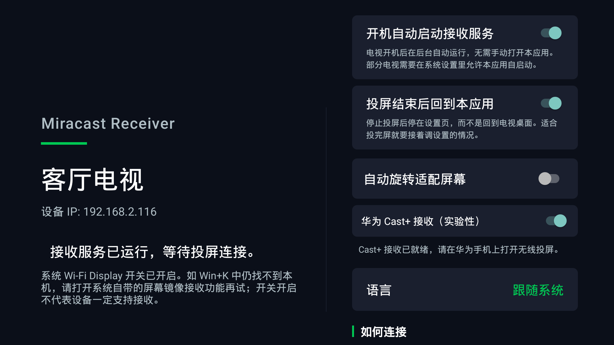
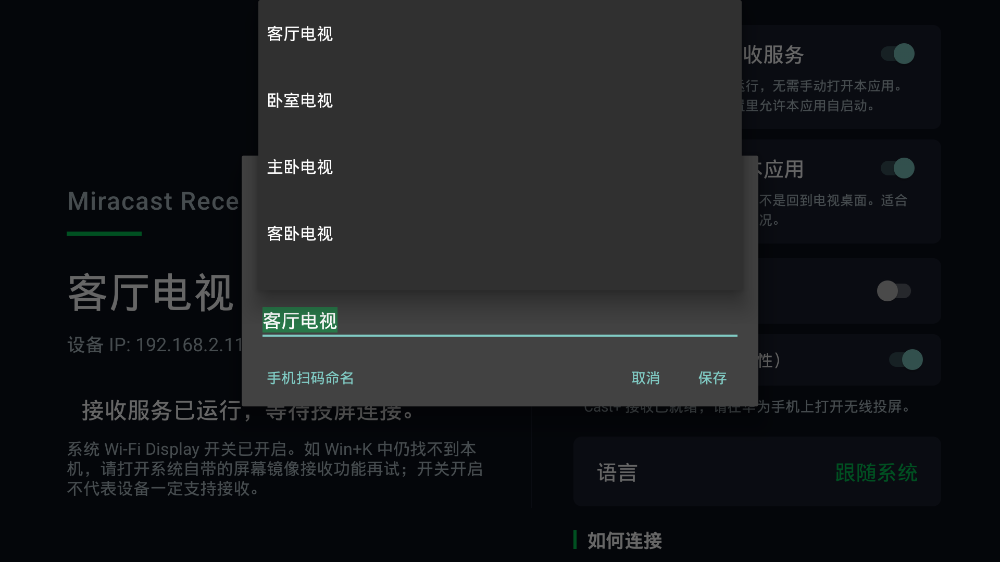
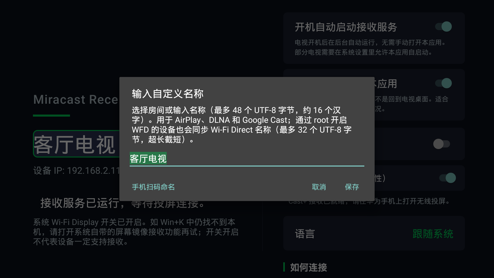

# Miracast Receiver for Android TV

[](https://opensource.org/licenses/MIT)
[](https://developer.android.com)
[](https://github.com/weekdayjast/MiracastReceiver/releases)

> 由于电视投屏广告日益猖獗，乐播投屏只允许本人快乐几分钟，本人深感震惊、愤怒、无奈，并在反复挣扎、彻夜难眠、认真思考三秒钟后，做出了一个违背祖宗的决定：
>
> 自己开发一个投屏 APK。
>
> 从此以后，我的电视我做主，我的投屏我掌控。
> 拒绝广告绑架，拒绝几分钟体验卡，拒绝看个视频还要先学习理财、买车、装宽带。
>
> 本项目将秉持“能用就行、能跑就好、不卡算赢”的核心理念，坚定走自主投屏、自研可控、自娱自乐的发展路线。
>
> 谨以此 APK，献给所有被投屏广告折磨过的灵魂。
>
> —— 一个被广告逼成开发者的人

一个功能强大的 Android TV 投屏接收端应用，支持多种投屏协议，让您的电视轻松接收来自手机、平板和电脑的投屏内容。

**已测试支持**：Bilibili、优酷、爱奇艺、Emby 等主流应用投屏

[English](#english) | [中文](#中文)

---

## 中文

### UxPlay 回归版本

ARM32 / ARM64 UxPlay 整理版保留已验证的 YouTube 播放、换片、字幕和镜像修复，清理临时协议日志并补齐现有语言资源。广告自动衔接与手机画质同步仍待验证。[详情](MiracastReceiver/AIRPLAY-UXPLAY.md)

v1.2.14 的 UxPlay 安装包要求 Android 6 及以上，应用 ID 为 `top.jast.miracastreceiver`。包名变化会作为新应用安装，旧应用的数据不会自动迁移；使用新版本前请退出旧接收器，避免端口冲突。

### ✨ 功能特性

- **🍎 AirPlay 支持**：完美支持 iPhone、iPad、Mac 投屏
  - 屏幕镜像（FairPlay 解密 + H.264 硬解码）
  - 视频投屏
  - 音频流播放

- **📺 DLNA/UPnP 支持**：兼容各平台 DLNA 客户端
  - Bilibili、优酷、爱奇艺等视频 App
  - Windows Media Player
  - VLC Player
  - Emby、Plex 等媒体服务器

- **Google Cast 媒体接收（实验性）**：复用 ExoPlayer 播放 HTTP/HTTPS 音视频，支持播放、暂停、跳转、音量和状态回传。仅实现 Default Media Receiver；不支持 Google 设备证书验证、YouTube 专用协议或屏幕镜像。详见 [能力范围与测试方法](MiracastReceiver/GOOGLE-CAST.md)。

- **华为 Cast+ 支持（实验性）**：在设置中开启后，可接收兼容华为手机的无线投屏，支持连接确认、PIN 码和画面旋转。已在 Sony Android 12 电视验证发现与投屏；其他机型仍需测试。详见 [启用方法与兼容范围](MiracastReceiver/HUAWEI-CASTPLUS.md)。

- **🖥️ Miracast/WFD**：Windows 无线显示器与安卓手机系统「投屏」共用的协议（**部分电视需要 root**，见[已知问题](#-已知问题)）
  - 完整 RTSP 会话协商（M1–M7）
  - MPEG-2 TS 解复用 + H.264 硬解码，直送 MediaCodec 低延迟渲染
  - AAC / LPCM 音频解码，收到即播，与画面同步输出
  - Wi-Fi Direct P2P + WFD IE 注入（Windows `Win+K`、安卓系统投屏均可直接发现）
  - 端到端延迟约 60–130 ms，可作为 Windows 的无线第二屏幕
  - 详见 [Windows 无线投屏 Root 配置说明](Windows无线投屏Root配置说明.md)

- **🎬 强大的播放能力**
  - 支持 HTTP/HTTPS 视频流
  - 支持 HLS（.m3u8）直播流
  - 支持多种视频格式（MP4、MKV、AVI 等）
  - 支持图片幻灯片播放
  - 倍速播放（0.5x - 2x）
  - 画质选择（480p - 1080p）

- **⚡ 开机自动启动**：电视开机后在后台自动拉起接收服务，无需手动打开应用
  - 等局域网 IP 就绪后再启动 AirPlay/DLNA/Miracast，避免开机瞬间广播绑错地址
  - 可在主界面的「开机自动启动接收服务」开关中关闭

### 📱 支持的投屏来源

| 平台 | 协议 | 状态 | 说明 |
|------|------|------|------|
| iPhone/iPad | AirPlay | ✅ 完美支持 | 屏幕镜像、视频、音频投屏 |
| Android 手机 | DLNA | ✅ 完美支持 | Bilibili、优酷等 App |
| Android 手机 | Miracast | ✅ 支持（部分需 root） | 系统自带「投屏」直接发现，整屏镜像含声音 |
| Windows | DLNA | ✅ 完美支持 | 媒体播放器投屏 |
| Windows | Miracast | ✅ 支持（部分需 root） | `Win+K` 直接发现，可当无线第二屏幕，含声音 |
| Mac | AirPlay | ✅ 完美支持 | 系统原生支持 |
| Emby/Plex | DLNA | ✅ 兼容 | 媒体服务器投屏 |

### 🚀 快速开始

#### 下载安装

1. 前往 [Releases](https://github.com/weekdayjast/MiracastReceiver/releases) 下载最新版本 APK
   - **ARM64 (推荐)**：适用于大多数现代 Android TV
   - **ARM32**：适用于老旧设备

2. 通过以下方式安装到 Android TV：
   - U 盘安装：复制 APK 到 U 盘，插入电视，用文件管理器打开安装
   - ADB 安装：`adb install app-release.apk`
   - 远程 ADB：`adb connect <TV_IP>:5555 && adb install app-release.apk`

#### 使用方法

1. 在 Android TV 上启动 **Miracast Receiver** 应用
2. 应用会显示设备名称、IP 地址和连接码
3. 根据你的设备选择投屏方式：

**iPhone/iPad 投屏**：
- 打开控制中心 → 屏幕镜像 → 选择 "Sony BRAVIA 4K VH22"（或你的设备名）
- 或在视频 App 中点击 AirPlay 图标

**Android 手机投屏**：
- 在支持 DLNA 的 App（如 Bilibili）中点击投屏按钮
- 选择显示的设备名称
- 或使用系统自带的「投屏 / 无线显示」整屏镜像（Miracast，部分电视需 root，见[已知问题](#-已知问题)）

**Windows 投屏**：
- 使用 VLC 或 Windows Media Player 的"播放到"功能
- 或使用 Emby、Plex 等媒体服务器
- 或按 `Win+K` 连接无线显示器（Miracast，部分电视需 root）

### 电视命名（Issue #33）

在应用主界面点击当前显示的设备名称，直接输入新名称；输入框支持下拉选择客厅、卧室、主卧、客卧、餐厅、书房等名称，也可输入自定义名称或恢复系统名称。选择「手机扫码命名」后，用同一局域网的手机扫码并在浏览器中保存；无需安装手机 App。二维码十分钟内有效，关闭窗口或离开应用后立即失效。

名称保存在本机，重启后保留；保存后刷新 AirPlay、DLNA 和 Google Cast 服务发现，重新打开手机投屏清单查看。中文名称最长约 16 字（48 个 UTF-8 字节）。通过 root 开启 WFD 的设备会同步 Wi-Fi Direct / Windows Win+K 名称，启动服务时也会重新应用。Wi-Fi Direct 最多 32 个 UTF-8 字节，超长名称会按完整字符截短；其他设备仍受系统权限限制。

以下截图来自 Sony 电视（192.168.2.116），示例名称为「客厅电视」。

1. 在主界面选中当前显示的电视名称，按遥控器确认键或直接点击。

   

2. 弹出名称输入框和备选清单，选择客厅、卧室、主卧等名称；需要自定义时收起清单，在输入框中编辑。

   

3. 确认输入框中的名称后点击「保存」，再重新打开手机投屏列表查看。也可点击「手机扫码命名」，通过同一局域网手机的浏览器修改并保存。

   

> 非 root 通过系统 Wi-Fi Direct 开启的 Miracast，列表名称仍可能是系统名称，应用内改名不保证同步；详见下方已知问题。

### 🛠️ 从源码构建

#### 环境要求

- Android Studio 2026.1+
- Android SDK API 36
- JDK 17+
- Gradle 8.11.1

#### 构建步骤

```bash
# 克隆仓库
git clone https://github.com/weekdayjast/MiracastReceiver.git
cd MiracastReceiver

# 构建 Debug APK
cd MiracastReceiver
./gradlew assembleDebug

# 构建 Release APK（需要配置签名）
./gradlew assembleRelease

# 生成 64 位和 32 位 APK
./gradlew assembleRelease -PbuildArm64=true
./gradlew assembleRelease -PbuildArm32=true
```

生成的 APK 位于：`app/build/outputs/apk/`

### 📖 文档

- [华为 Cast+ 实验性接收](MiracastReceiver/HUAWEI-CASTPLUS.md) - 启用方式、实现范围和验证清单
- [ADB 故障日志采集教程](ADB故障日志采集教程.md) - 故障复现、电视 / 盒子日志采集与 Issue 反馈要求
- [开发与调试指南](开发与调试指南.md) - 完整的开发、打包、安装和调试说明
- [Windows 无线投屏 Root 配置说明](Windows无线投屏Root配置说明.md) - Miracast 启用步骤、协议实现要点与排错
- [Windows 无线显示器](Windows无线显示器支持说明.md) - Miracast 协议背景说明

### 🔧 技术栈

- **语言**：Kotlin
- **最低 SDK**：Android 5.0 (API 21)
- **目标 SDK**：Android 14 (API 36)
- **UI 框架**：Android TV Leanback
- **视频播放**：ExoPlayer (Media3)
- **网络**：OkHttp, mDNS/NSD
- **协议**：AirPlay, DLNA/UPnP, Miracast/WFD, RTSP, RTP

### 🙏 致谢与参考

- 感谢 [UxPlay](https://github.com/FDH2/UxPlay) 提供 AirPlay 协议实现，以及 [android-airplay-server](https://github.com/jqssun/android-airplay-server) 提供 Android 接入与渲染参考；相关代码保留各自的许可证与来源声明。

- AirPlay 屏幕镜像实现借鉴并参考了 [PhairPlay](https://github.com/mazer666/PhairPlay) 项目的协议流程与实现思路。
- Google Cast 媒体接收参考了 [openchromecast](https://github.com/yukarikaname/openchromecast) 的协议定义与实现流程，保留其 MIT 许可声明。

### 🐛 已知问题

1. **Miracast（Windows 无线显示器 / 安卓系统投屏）在部分电视上需要 root**
   - 电视要被 Windows `Win+K` 和安卓系统投屏发现，必须对外广播 WFD IE
   - **系统自带「屏幕镜像」功能的电视（如 Sony BRAVIA）无需 root**：系统已经在广播 WFD IE，
     本应用直接接管会话。可用 `adb shell settings get global wifi_display_on` 确认，返回 `1` 即属于此类
   - 系统不带该功能的电视：广播 WFD IE 需要 signature 级权限 `CONFIGURE_WIFI_DISPLAY`，
     普通应用拿不到，只能在 root 后由应用自动注入；未 root 则无法使用，请改用 DLNA 投屏
   - 连接时电视上弹出「是否允许连接」的确认框是系统的 Wi-Fi Direct 授权流程，确认即可
   - 详见 [Windows 无线投屏 Root 配置说明](Windows无线投屏Root配置说明.md)

2. **Emby 投屏兼容性**
   - 部分 Emby 客户端的 SOAP 请求格式可能需要特殊处理

3. **非 root 开启 Wi-Fi Direct 投屏时，Miracast 名称可能显示不正确**
   - 非 root 设备使用系统 Wi-Fi Direct / 屏幕镜像功能开启投屏时，安卓手机和 Windows `Win+K` 列表可能仍显示 `Android_xxxx` 或系统型号，与应用内设置的电视名称不一致
   - 列表中的名称是系统管理的 Wi-Fi Direct 设备名；应用内直接改名或扫码保存名称，无法保证同步修改非 root 设备的该名称
   - Android 11 起修改该名称需要 `NETWORK_SETTINGS` 等系统级权限，普通应用无法修改，
     只能保持系统默认的 `Android_xxxx`
   - 如果电视的「设置 → 网络」里有 Wi-Fi Direct 设置页，可以在那里改名；没有该设置页时，通过 root 开启 WFD 的设备会由本应用同步名称
   - AirPlay / DLNA / Google Cast 使用应用内「电视名称」；未设置时使用电视系统设备名称

4. **需要「显示在其他应用上层」权限**
   - Android 10 起系统禁止后台弹出界面。未打开本应用时（开机自启后、或退回桌面后）投屏，
     播放页会被系统拦截，表现为投屏没有反应
   - 首次打开应用时会弹窗引导到系统设置页开启；如果电视没有该设置页，可用 adb 开启：
     `adb shell appops set top.jast.miracastreceiver SYSTEM_ALERT_WINDOW allow`

5. **Android Miracast 屏幕旋转后的分辨率声明尚未解决**
   - 已支持接收端旋转、角度保存和黑边内容适配，但部分 Android 发送端仍选择横屏 1920×1080 视频帧，将竖屏内容缩小后加黑边发送
   - 当前自定义分辨率扩展仅对支持该扩展的发送端生效；旋转、重连后仍不能保证按接收设备实际分辨率交换宽高
   - 放大显示无法恢复源端已经损失的细节，旋转后的清晰度仍可能偏低。详见 [Miracast 旋转说明](MiracastReceiver/MIRACAST-ROTATION.md)

### 🗺️ 后续计划

- **完善 AirPlay 支持**
  - 优化屏幕镜像稳定性和延迟
  - 优化音视频同步

- **完善 Miracast 投屏（Windows / 安卓）**（音视频已可用，见 [Root 配置说明](Windows无线投屏Root配置说明.md)）
  - 进一步压低延迟（当前约 60–130 ms）
  - 支持 `wfd_idr_request_capability`，丢包后主动请求关键帧以加快恢复
  - 探索按需建组，避免常驻占用 Wi-Fi Direct 接口

### 🤝 贡献

欢迎提交 Issue 和 Pull Request！

### 📄 许可证

本项目采用 MIT 许可证 - 详见 [LICENSE](LICENSE) 文件

---

## English

### ✨ Features

- **🍎 AirPlay Support**: Perfect compatibility with iPhone, iPad, and Mac
  - Screen mirroring (FairPlay decryption + H.264 hardware decoding)
  - Video casting
  - Audio streaming

- **📺 DLNA/UPnP Support**: Compatible with DLNA clients across platforms
  - Bilibili, Youku, iQiyi video apps
  - Windows Media Player
  - VLC Player
  - Emby, Plex media servers

- **Experimental Google Cast media receiver**: HTTP/HTTPS audio/video through ExoPlayer with playback controls and status feedback. Implements the Default Media Receiver; Google device-certificate validation, YouTube-specific protocols and screen mirroring are unsupported. See [scope and testing](MiracastReceiver/GOOGLE-CAST.md).

- **Huawei Cast+ support (experimental)**: Enable it in settings to receive wireless mirroring from compatible Huawei phones, with connection approval, PIN codes and rotation. Discovery and mirroring have been verified on a Sony Android 12 TV; other devices need testing. See [setup and scope](MiracastReceiver/HUAWEI-CASTPLUS.md).

- **🖥️ Miracast/WFD**: The protocol behind both Windows Wireless Display and Android's built-in screen casting (**root required on some TVs**, see [Known Issues](#-known-issues))
  - Full RTSP session negotiation (M1–M7)
  - MPEG-2 TS demuxing + H.264 hardware decoding, fed straight to MediaCodec
  - AAC / LPCM audio decoding, played as it arrives alongside the video
  - Wi-Fi Direct P2P with WFD IE injection (discoverable via `Win+K` and Android screen casting)
  - ~60–130 ms end-to-end latency, usable as a wireless second display
  - See [Root Setup Guide](Windows无线投屏Root配置说明.md) (Chinese)

- **🎬 Powerful Playback**
  - HTTP/HTTPS video streams
  - HLS (.m3u8) live streams
  - Multiple video formats (MP4, MKV, AVI, etc.)
  - Image slideshow
  - Playback speed control (0.5x - 2x)
  - Quality selection (480p - 1080p)

- **⚡ Auto-start on boot**: The receiver service starts in the background after the TV boots, no need to open the app
  - Waits for a LAN IP before starting AirPlay/DLNA/Miracast, so advertisements never bind to the wrong address
  - Can be turned off with the "开机自动启动接收服务" switch on the main screen

### 📱 Supported Sources

| Platform | Protocol | Status | Notes |
|----------|----------|--------|-------|
| iPhone/iPad | AirPlay | ✅ Perfect | Screen mirroring, video, audio casting |
| Android | DLNA | ✅ Perfect | Bilibili, Youku apps |
| Android | Miracast | ✅ Supported (root on some TVs) | Found by the built-in screen cast, full mirroring with audio |
| Windows | DLNA | ✅ Perfect | Media player casting |
| Windows | Miracast | ✅ Supported (root on some TVs) | Discoverable via `Win+K`, works as second display, with audio |
| Mac | AirPlay | ✅ Perfect | Native system support |
| Emby/Plex | DLNA | ✅ Compatible | Media server casting |

### 🚀 Quick Start

#### Download & Install

1. Download the latest APK from [Releases](https://github.com/weekdayjast/MiracastReceiver/releases)
   - **ARM64 (Recommended)**: For most modern Android TVs
   - **ARM32**: For older devices

2. Install on Android TV:
   - USB: Copy APK to USB drive, plug into TV, install via file manager
   - ADB: `adb install app-release.apk`
   - Remote ADB: `adb connect <TV_IP>:5555 && adb install app-release.apk`

#### Usage

1. Launch **Miracast Receiver** on your Android TV
2. The app displays device name, IP address, and connection code
3. Cast from your device:

**iPhone/iPad**:
- Control Center → Screen Mirroring → Select your TV name
- Or tap AirPlay icon in video apps

**Android Phone**:
- Tap cast button in DLNA-enabled apps (e.g., Bilibili)
- Select the displayed device name
- Or use the system's built-in screen cast / wireless display (Miracast, root required on some TVs — see [Known Issues](#-known-issues))

**Windows**:
- Use "Play To" in VLC or Windows Media Player
- Or cast from Emby, Plex media servers
- Or press `Win+K` to connect a wireless display (Miracast, root required on some TVs)

### TV names (Issue #33)

Click the displayed device name on the main screen to edit it directly. The input offers room presets and the system name in its dropdown, and a button opens a QR code for a phone on the same LAN. Open the scanned link in a browser and save; no phone app is required. The QR link expires after ten minutes or when the dialog closes or the app leaves the foreground.

Names persist across restarts and refresh AirPlay, DLNA and Google Cast discovery without restarting playback. Reopen the sender’s device list after saving. Custom names allow up to 48 UTF-8 bytes. Devices enabling WFD through root also synchronize the Wi-Fi Direct / Windows Win+K name, including at service startup. Wi-Fi Direct names are shortened at complete character boundaries to 32 UTF-8 bytes; other devices remain subject to system permissions.

Screenshots from the Sony TV at 192.168.2.116 (Chinese UI): select the current name on the [home screen](docs/images/tv-name-home.png), choose a [room preset](docs/images/tv-name-presets.png) or type a custom name, then [save](docs/images/tv-name-edit.png). The same dialog offers QR naming from a phone browser on the same LAN. Non-root system Wi-Fi Direct names may remain unchanged; see Known Issues below.

### 🛠️ Build from Source

#### Requirements

- Android Studio 2026.1+
- Android SDK API 36
- JDK 17+
- Gradle 8.11.1

#### Build Steps

```bash
# Clone repository
git clone https://github.com/weekdayjast/MiracastReceiver.git
cd MiracastReceiver

# Build debug APK
cd MiracastReceiver
./gradlew assembleDebug

# Build release APK (requires signing configuration)
./gradlew assembleRelease

# Build 64-bit and 32-bit APKs
./gradlew assembleRelease -PbuildArm64=true
./gradlew assembleRelease -PbuildArm32=true
```

Output APKs: `app/build/outputs/apk/`

### 📖 Documentation

- [Development Guide](开发与调试指南.md) - Complete development, packaging, installation, and debugging instructions (Chinese)
- [Miracast Root Setup](Windows无线投屏Root配置说明.md) - Enabling steps, protocol implementation notes, troubleshooting (Chinese)
- [Windows Wireless Display](Windows无线显示器支持说明.md) - Miracast protocol background (Chinese)

### 🔧 Tech Stack

- **Language**: Kotlin
- **Min SDK**: Android 5.0 (API 21)
- **Target SDK**: Android 14 (API 36)
- **UI Framework**: Android TV Leanback
- **Video Player**: ExoPlayer (Media3)
- **Networking**: OkHttp, mDNS/NSD
- **Protocols**: AirPlay, DLNA/UPnP, Miracast/WFD, RTSP, RTP

### 🙏 Acknowledgements & References

- Thanks to [UxPlay](https://github.com/FDH2/UxPlay) for its AirPlay protocol implementation and [android-airplay-server](https://github.com/jqssun/android-airplay-server) for the Android integration and rendering reference. Their license and source notices are retained.

- AirPlay screen mirroring is inspired by and references the protocol flow and implementation ideas from [PhairPlay](https://github.com/mazer666/PhairPlay).
- Google Cast media reception references [openchromecast](https://github.com/yukarikaname/openchromecast), with its MIT copyright and license retained.

### 🐛 Known Issues

1. **Miracast (Windows Wireless Display / Android Screen Cast) Requires Root on Some TVs**
   - To be found by Windows `Win+K` and Android screen casting, the TV must broadcast the WFD IE
   - **TVs with built-in screen mirroring (e.g. Sony BRAVIA) need no root**: the system already broadcasts the WFD IE
     and the app takes over the session. Check with `adb shell settings get global wifi_display_on` — `1` means this case
   - On other TVs, broadcasting the WFD IE requires the signature-level `CONFIGURE_WIFI_DISPLAY` permission,
     so the app can only inject it after rooting; without root, use DLNA casting instead
   - The "allow connection?" prompt on the TV when connecting is the system's Wi-Fi Direct authorization — just confirm it
   - See [Root Setup Guide](Windows无线投屏Root配置说明.md) (Chinese)

2. **Emby Casting Compatibility**
   - Some Emby clients may require special SOAP format handling

3. **Incorrect Miracast name with non-root Wi-Fi Direct casting**
   - On non-root devices using system Wi-Fi Direct / screen mirroring, Android casting and Windows `Win+K` may show `Android_xxxx` or the system model instead of the TV name configured in the app
   - This Wi-Fi Direct name is system-managed; renaming in the app or via the QR page cannot guarantee it will be synchronized on non-root devices
   - Since Android 11, renaming it requires system permissions such as `NETWORK_SETTINGS`, so the app
     cannot change it and the system default `Android_xxxx` remains
   - If the TV has a Wi-Fi Direct page under Settings → Network, rename it there; otherwise devices enabling WFD through root synchronize the name through this app
   - AirPlay / DLNA / Google Cast use the app’s TV name, falling back to the TV system device name

4. **"Display over other apps" permission required**
   - Since Android 10, apps may not open screens from the background. When the app is not open
     (after auto-start on boot, or after returning to the home screen), the player is blocked and casting appears to do nothing
   - The app prompts for it on first launch and opens the system settings page; if the TV has no such page, grant it via adb:
     `adb shell appops set top.jast.miracastreceiver SYSTEM_ALERT_WINDOW allow`

5. **Unresolved: resolution declaration after rotating Android Miracast**
   - Receiver rotation, saved angles and black-bar fitting are supported, but some Android senders still transmit portrait content inside a landscape 1920×1080 frame
   - Custom resolution extensions work only with compatible senders; rotating and reconnecting do not guarantee a stream matching the receiver’s actual dimensions with width and height exchanged
   - Enlarging the content cannot recover detail already lost at the sender, so rotated mirroring can remain blurry. See [rotation details](MiracastReceiver/MIRACAST-ROTATION.md)

### 🗺️ Roadmap

- **Enhance AirPlay Support**
  - Optimize screen mirroring stability and latency
  - Improve audio-video synchronization

- **Complete Miracast Casting (Windows / Android)** (audio and video work — see [Root Setup Guide](Windows无线投屏Root配置说明.md))
  - Push latency down further (currently ~60–130 ms)
  - Support `wfd_idr_request_capability` to request a keyframe after packet loss
  - Explore on-demand group creation instead of holding the Wi-Fi Direct interface permanently

### 🤝 Contributing

Issues and Pull Requests are welcome!

### 📄 License

This project is licensed under the MIT License - see [LICENSE](LICENSE) file for details

---

## 📞 Contact

- GitHub Issues: [https://github.com/weekdayjast/MiracastReceiver/issues](https://github.com/weekdayjast/MiracastReceiver/issues)

## ⭐ Star History

If you find this project helpful, please give it a star!

## 🙏 贡献者感谢 / Contributors

感谢以下贡献者为项目贡献代码、功能改进和设备验证，也感谢所有提交问题、提供日志和参与测试的朋友。

Thanks to the following contributors for their code, improvements, and device testing, and to everyone who reports issues, shares logs, and helps test the app.

| 贡献者 / Contributor |
| --- |
| [@arjuntam](https://github.com/arjuntam) |
| [@Googler0825](https://github.com/Googler0825) |
| [@aby1987](https://github.com/aby1987) |
| [@dcstf](https://github.com/dcstf) |

[查看完整贡献者名单 / View all contributors](https://github.com/weekdayjast/MiracastReceiver/graphs/contributors)
